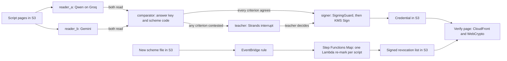

# Docket

**When the exam board corrects its marking scheme, which students' grades are now wrong, and who fixes them?** Docket marks photos of handwritten exam scripts. A vision model transcribes what the student wrote, plain code checks it against the answer key and applies the official marking scheme, and a teacher decides anything two readers disagree on, through a Strands Graph interrupt. AWS KMS signs each result, and anyone can verify it in a browser with no account. When the scheme changes, one file landing in S3 re-marks every script, re-issues the grades that moved and revokes the old ones on a signed list.

**[Live verify page](https://d37lfktm8wxh76.cloudfront.net)** · **[Demo video, under 3 minutes](YOUTUBE_URL)** · **[Builder Center project](PROJECT_URL)**

Built for the AWS Builder Center hackathon Strands SDK: Workshop to Ship, Education focus area, by [@ashutosh887](https://github.com/ashutosh887). Release [`v1.0.0`](https://github.com/ashutosh887/docket/releases/tag/v1.0.0) is the code as submitted.

## Measured

**16 of 21 exact on task 13, against a published best of 12 of 21.** On the 21 task-13 scripts of CHECK-MAT, real handwritten exam solutions with official expert grades, Docket's reader B plus the code answer key matched the official grade on **16 of 21 (76.2%)** and came within one point on **20 of 21**. The dataset authors' best published result on the same 21 scripts is 12 of 21. At n = 21 that gap is not statistically significant (McNemar p = 0.29). Across all four tasks with answer keys, Docket matched 33 of 47.

| Setup, task 13 | Exact | Within one | Scripts | Source |
|---|---|---|---|---|
| **Design 2: reader B transcribes, code checks the answer key** (`gemini:gemini-3.5-flash-lite`, one reader) | **16 of 21, 76.2%** (95% CI 54.9 to 89.4) | **20 of 21, 95.2%** (95% CI 77.3 to 99.2) | all 21 | [`single_reader_d2_b.json`](eval/results/single_reader_d2_b.json) |
| Published, not run by Docket: `google/gemini-2.0-flash-001`, with the true solution, same 21 scripts | 12 of 21, 57.1% | 95.2% | all 21 | [`published_baselines.json`](eval/results/published_baselines.json) |
| Design 1: two readers judge each criterion, signed with no teacher | 2 of 6, 33.3% (95% CI 9.7 to 70.0) | 4 of 6 | 6 of 10 signed | [`agreement_d1.json`](eval/results/agreement_d1.json) |
| Design 1: teacher-free floor (a disputed criterion takes the lower reading) | 5 of 10, 50.0% | 8 of 10 | all 10 | same |
| Design 1: reader A alone (`groq:qwen/qwen3.8-27b`) | 4 of 10, 40.0% | 8 of 10 | all 10 | same |
| Design 1: reader B alone (`gemini:gemini-3.5-flash-lite`) | 4 of 10, 40.0% | 8 of 10 | all 10 | same |

Paired on the same 21 scripts, design 2 was right on 6 where the published result was wrong, and wrong on 2 where it was right. The exact McNemar p is 0.29. On the 10 scripts both designs read, design 2 beat design 1's reader B on 3 and lost on 1, with p = 0.63. On the 10 task-13 scripts that all three runs of design 2 share, each run matched 6 of 10, so the run-to-run spread is 0 points. Those 10 are harder than the rest. Run 1 matched 10 of the other 11.

**Beyond task 13 the number is lower, and below the published best.** Answer keys now also cover task 15 (inequality), task 16 (loan word problem) and task 18 (parameter), each key checked in code (Amendment 7 in `docs/proof.md`). On the 26 scripts of those tasks in the seeded 61, reader B plus the key matched the official grade on 17 of 26 and came within one point on 21 of 26. The dataset authors' best published result on the same 26 scripts is `openai/o4-mini` at 19 of 26. Paired, Docket was right on 3 where it was wrong and wrong on 5 where it was right (McNemar p = 0.73). On the 9 of those scripts that all three runs share, each run matched 6 of 9, a spread of 0 points.

| Setup, tasks 15, 16 and 18, reader B + code key (one reader) | Exact | Within one | Best published on the same scripts | Source |
|---|---|---|---|---|
| Task 15, inequality | 7 of 10, 70.0% (95% CI 39.7 to 89.2) | 7 of 10 | `openai/o4-mini`, 7 of 10 | [`single_reader_d2_b_keyed.json`](eval/results/single_reader_d2_b_keyed.json) |
| Task 16, loan word problem | 5 of 8, 62.5% (95% CI 30.6 to 86.3) | 8 of 8 | `openai/o4-mini`, 6 of 8 | same |
| Task 18, parameter | 5 of 8, 62.5% (95% CI 30.6 to 86.3) | 6 of 8 | `openai/o4-mini`, 6 of 8 | same |
| **Pooled** | **17 of 26, 65.4%** (95% CI 46.2 to 80.6) | **21 of 26, 80.8%** (95% CI 62.1 to 91.5) | `openai/o4-mini`, 19 of 26 | same |

Tasks 14, 17 and 19 have no keys. Their points rest on a proof or an argued example, which code cannot check.

**The first design failed, so correctness moved into code.** In design 1 each reader judged whether a criterion was met. When both agreed, Docket signed. It signed 6 of 10 scripts without a teacher, and only 2 of those 6 matched the official grade. When two readers agree on a wrong judgement, the grade is still wrong. In design 2 the readers only transcribe the student's roots, and code decides whether they are right by checking them against an answer key it has verified itself.

### Robustness

| Check | Result | Source |
|---|---|---|
| One character or one byte changed, at every position of 12 KMS-signed credentials and the signed revocation list, verified by the page's own code and by Python | **10,258 of 10,258 rejected**; 13 of 13 untouched controls verify | [`tamper.json`](eval/results/tamper.json) |
| Bad readings injected before signing: missing reading, stale scheme, dropped criterion, stale definition, declined reader, 10 of each | **50 of 50 blocked** by `SigningGuard`; 10 of 10 clean controls signed | [`guard_d1.json`](eval/results/guard_d1.json) |
| Scheme `v1` to `v2`, 10 scripts, live KMS | 10 re-marked, **2 re-issued, 2 revoked**, 8 unchanged, **1.1 s, 0 model calls**, 10 of 10 checks pass | [`remark_d1.json`](eval/results/remark_d1.json) |
| The same re-mark on AWS: `schemes/v2.json` into S3 → EventBridge → Step Functions Map → Lambda | SUCCEEDED in **3.6 s**: 9 re-marked, 2 re-issued, 7 unchanged, revocation list re-signed with 2 entries | Step Functions execution `4d4bdc28-f2bf-d83a-6c4a-23d880efb3ad_daa9eda0-...`, 15:10 IST |
| Who can sign | KMS key policy denies `kms:Sign` to every principal but the Lambda role and the build role; a call from another IAM user returned `AccessDeniedException ... explicit deny in a resource-based policy` | CloudTrail event `9b18bfbd-76b5-49a4-902b-3cabf66dc11a` |
| Every signature on record | CloudTrail event history: 12 `Sign` events for the AWS run, all by the Lambda role: 11 credentials and 1 revocation list | CloudTrail `LookupEvents` |
| Strands trajectory eval ([strands-agents-evals](https://pypi.org/project/strands-agents-evals/) 1.8.0): 22 cached reader pairs replayed through the Graph, node trail checked against the routing rule | **22 of 22 follow the rule**: 13 agreed cases go readers, comparator, signer and are decided by code; 9 contested cases pause on the teacher interrupt first. 0 model calls | [`trajectory.json`](eval/results/trajectory.json) |
| Appeals on 2 scripts, cached readings, reader order swapped | 13.3.3 **upheld, 0 to 1 of 2**, new credential signed and the old one superseded; 13.5.1 reviewed, **1 of 2 unchanged**. Both appeal records KMS-signed. 0 model calls | [`examples/site-data/appeals/`](examples/site-data/appeals/) |
| Blind check: reader B gets the request with the student's pages removed | Declined on **2 of 10**; on the other 8 it returned an empty reading that code scored 0 points. No points were given, but it did not refuse | [`blind.json`](eval/results/blind.json) |

Speed and cost, design 1, both readers: median 91.2 s per script, bounded by the Groq call on 7 of 10 scripts. Free tier: $0. At list prices the two readings would cost $0.005466 a script ([`speed_cost_d1.json`](eval/results/speed_cost_d1.json)).

The bar was committed before the first counted reading, with dated amendments when free-tier limits forced changes: [`docs/proof.md`](docs/proof.md).

## Features

- **Marking with a teacher in the loop.** Two readers from different model families read every script. Code scores it. Any criterion the readers disagree on stops the Graph for the teacher.
- **Signed grades.** Every grade is a KMS-signed credential that the [verify page](https://d37lfktm8wxh76.cloudfront.net) checks in the browser, with no account.
- **Re-marking on a scheme change.** A new scheme file in S3 re-marks every script from cached readings, re-issues the grades that moved and revokes the old ones on a signed list. 1.1 s locally, 3.6 s on AWS.
- **Appeals.** A student can ask for a grade to be checked again. `docket appeal 13.3.3 --reason "..."` re-marks the script from its cached readings with the reader order swapped and sends the appealed criteria to the teacher. If the grade changes, Docket signs a new credential and puts the old one on the revocation list as `superseded` (`appeal upheld: <reason>`). If it does not, it signs an appeal record that says `appeal reviewed, grade unchanged`. No model is called.
- **Moderation.** An exam board samples marked scripts against an expert. The page's Moderation tab does that for the class set, counted from the published data: 6 of 27 criteria went to a teacher, and 4 of 9 signed grades are above the official grade (13.1.4, 13.3.4, 13.5.2, 13.6.3). Both readers agreed on all 4, so no teacher saw them. Those are design-1 grades, the failure design 2 was built to fix.

## How it works

The rule is one sentence: **the model reads, code decides.** Readers return structured readings. Plain code owns correctness, points, totals, routing, signing and re-marking.



1. **Read.** Each reader is a Strands `Agent` with structured output. In design 2 it transcribes, per part of the task, whether work is present and legible, the root families of part (a) as fractions of pi, the roots of part (b), and whether any error is only computational. It never says whether an answer is right.
2. **Check.** [`answers.py`](src/docket/answers.py) compares the transcript with the task's answer key in [`src/docket/keys/`](src/docket/keys/). Two families count as the same answer when they give the same set of angles, so `pi/3 + 2pi k/3` equals `pi + 2pi k, ±pi/3 + 2pi k`. Each key is checked in code before use: every family member is substituted into the equation, part (b) is re-derived from part (a) on the interval, and 20,000 grid points are scanned for a root the key misses.
3. **Score.** [`scheme.py`](src/docket/scheme.py) turns K1, K2 and K3 into points under the versioned scheme.
4. **Route.** If the two readers' transcripts differ on a criterion, or a part is illegible, that criterion goes to the teacher. Otherwise the script goes to the signer.
5. **Decide.** The teacher sees both readings, decides the contested criteria, and the Graph resumes.
6. **Sign.** `SigningGuard` checks the case, then KMS signs the canonical JSON of the credential.
7. **Re-mark.** A new scheme version re-marks every script from cached readings, re-issues the credentials whose grade moved, and re-signs the revocation list.
8. **Appeal.** The same Graph runs again on the cached readings with the readers swapped, and the appealed criteria go to the teacher through the same interrupt.

A credential, as served by the live page (signature shortened):

```json
{
  "credentialId": "dkt_13.2.3_v1_1",
  "scriptId": "13.2.3",
  "imageSha256": "c1f1d46c7015569e23f673b900ee42833fff61eb67c56e81be7e8740d23b433c",
  "schemeId": "ege-profile-math-task-13",
  "schemeVersion": "v1",
  "criteria": [
    {"id": "K1", "points": 1, "max": 1, "readerA": 1, "readerB": 1, "margin": 0.1, "decidedBy": "code"},
    {"id": "K2", "points": 0, "max": 1, "readerA": 1, "readerB": 0, "margin": 0.7, "decidedBy": "teacher"},
    {"id": "K3", "points": 0, "max": 1, "readerA": 1, "readerB": 0, "margin": 0.85, "decidedBy": "teacher"}
  ],
  "total": 1,
  "max": 2,
  "readers": {"a": "groq:qwen/qwen3.8-27b", "b": "gemini:gemini-3.5-flash-lite"},
  "teacher": {"decided": ["K2", "K3"], "note": "official expert grade (stand-in for the teacher)"},
  "route": "teacher",
  "design": 1,
  "issuedAt": "2026-11-04T09:40:06Z",
  "supersedes": null,
  "signature": {"alg": "ECDSA_SHA_256", "keyId": "arn:aws:kms:ap-south-1:960149837193:key/3e29a662-62e2-4526-aacf-28f7b0722921", "value": "MEYCIQDklPUPgA5S6hUD5yg2L6K75fd910hUXM2h81gAOU2Z9QIhAK+9..."}
}
```

The signed bytes are the canonical JSON of the credential without `signature`: sorted keys, no spaces, UTF-8, whole-number floats written as integers. Docket takes its SHA-256 and calls KMS `Sign` with `MessageType=DIGEST`. The page converts KMS's DER signature to raw `r||s` for WebCrypto, with strict DER parsing.

## Technical execution with the Strands Agents SDK

strands-agents 1.63.0.

| Construct | Where | What it decides |
|---|---|---|
| `GraphBuilder`: two reader entry points, `add_edge(..., condition=both_read)` into the comparator, `condition=routed("signer", ...)` or `routed("teacher")` out of it | [`graph.py`](src/docket/graph.py) | Straight to the signer, or stop for the teacher. A model never picks the edge |
| `TeacherInterrupt`, a `HookProvider` on `BeforeNodeCallEvent` calling `event.interrupt("teacher", reason=...)` | [`graph.py`](src/docket/graph.py) | The Graph returns `Status.INTERRUPTED` with every contested criterion and both readings; `interruptResponse` resumes it |
| `S3SessionManager` (or `FileSessionManager` locally), session `docket-<script>-<version>` | [`graph.py`](src/docket/graph.py) | The interrupted Graph state survives the process: interrupted in one handler invocation, resumed in a separate one |
| `SigningGuard`, a `HookProvider` on `BeforeNodeCallEvent` setting `event.cancel_node` | [`graph.py`](src/docket/graph.py) | No signature with a missing reading, a declined reader, a missing criterion, a stale definition, a stale scheme or an undecided contested criterion |
| `Agent.invoke_async(..., structured_output_model=...)` | [`readers.py`](src/docket/readers.py) | Typed readings; the comparator reads fields, never prose |
| `strands-agents-evals` `Case`, `Experiment`, `StateEquals` and `exact_match_scorer` on the node trail from a `BeforeNodeCallEvent` hook | [`eval/trajectory_eval.py`](eval/trajectory_eval.py) | Proves the route: 22 of 22 replayed cases take the path the routing rule names |
| `OpenAIModel` pointed at Groq, `GeminiModel` | [`readers.py`](src/docket/readers.py) | Which model reads, one environment variable each: `DOCKET_READER_A`, `DOCKET_READER_B` |

Beyond the workshop, which builds one agent with tools, a hook, steering, sessions, AgentCore, delegation and evals, Docket uses a Graph whose edges are code conditions, an interrupt that waits for a person across processes, a hook that guards signing, two model families through two providers, an appeal that reruns the Graph with the readers swapped, a trajectory eval of the Graph's routing, and a preregistered evaluation scored against official expert grades.

## Originality: AWS services and what each decides

All in `ap-south-1`, one CDK stack `DocketStack` in [`infra/`](infra/). Nothing with an hourly price.

| Service | What it does here |
|---|---|
| AWS KMS | Key `alias/docket-credentials`, `ECC_NIST_P256`, `SIGN_VERIFY`, `ECDSA_SHA_256`. Signs every credential and the revocation list. The key policy denies `kms:Sign` to all but the Lambda role and the build role |
| Amazon S3 | A private data bucket (scans, readings cache, sessions, pending interrupts, credentials, `revocations.json`) and a private site bucket |
| Amazon CloudFront | Distribution `E128IQWEBE8CGT` serves the page and `/data/*` through Origin Access Control. The page verifies in the browser against [`/keys/docket-public.pem`](https://d37lfktm8wxh76.cloudfront.net/keys/docket-public.pem) |
| Amazon EventBridge | A new `schemes/*.json` object in the data bucket starts the re-mark state machine |
| AWS Step Functions | Re-mark: read scheme, bump, Map of `remark` per script, publish revocations, reindex. Batch: Map of `mark` over scans |
| AWS Lambda | `RemarkScript` runs `docket.aws_handler.handler`, the same code as the CLI: Python 3.12, arm64, 1,024 MB, 900 s |
| AWS Systems Manager | Reader keys as SecureString parameters `/docket/GROQ_API_KEY` and `/docket/GOOGLE_API_KEY`, standard tier |
| AWS CloudTrail | Event history records every KMS `Sign` call, with no trail configured |

## Social impact

Where trained markers are scarce, handwritten scripts wait, or get marked with no second reading. When a scheme is corrected or an appeal upheld, finding which grades are now wrong means reading every script again by hand.

Docket moves the judgement of whether an answer is right out of the model and into code that checks an answer key. Every disagreement between readers reaches a human. Every grade a scheme change makes wrong is found and re-issued, and the old one revoked, in 3.6 seconds on AWS. A student who appeals gets a signed answer either way. Anyone can check any grade without an account.

It is for an exam board's moderation team or a school network's assessment lead, deploying it in their own AWS account. The event page notes that "participating organizations can also apply for AWS Social Impact Credits if they choose", and an organisation like that is who could.

Docket does not claim students learn more. It claims marks you can check, correct and audit.

## Communication: try it

1. Open [the verify page](https://d37lfktm8wxh76.cloudfront.net). No login.
2. Open `dkt_13.1.1_v1_1`. It verifies in your browser.
3. Change one character. It says the signature is invalid.
4. Open `dkt_13.2.3_v1_1`. It says superseded, gives the reason, and links `dkt_13.2.3_v2_1`.
5. Open `dkt_13.1.4_v1_1`. Docket gave 2 and the official grade is 1. It is a design-1 grade both readers agreed on, shown on purpose.
6. Open the Appeals tab. 13.3.3 was upheld, 0 to 1 of 2, and `dkt_13.3.3_v2_1` now reads "Superseded: appeal upheld".
7. Open the Moderation tab. It lists the 4 signed grades that differ from the official one.

Or watch the [video](YOUTUBE_URL).

## Quickstart

Python 3.12 and [uv](https://docs.astral.sh/uv/). Verifying needs no keys and no network:

```sh
git clone https://github.com/ashutosh887/docket
cd docket
uv sync
uv run python -m docket verify examples/site-data/credentials/dkt_13.2.3_v1_1.json --revocations examples/site-data/revocations.json
```

```json
{
  "credentialId": "dkt_13.2.3_v1_1",
  "status": "superseded",
  "reason": "scheme v1 -> v2: total 1 -> 0. Demonstration amendment (not an FIPI change): on task 13, 1 point now requires that every step of both parts is correct with any wrong answer caused only by a computational error (K3); a correct part (a) next to a wrong root selection in part (b) no longer earns it.",
  "replacedBy": "dkt_13.2.3_v2_1"
}
```

Marking needs `GROQ_API_KEY` and `GOOGLE_API_KEY` in `.env`, and AWS credentials allowed to call `kms:Sign` on `alias/docket-credentials`:

```sh
uv run python scripts/fetch_checkmat.py              # CHECK-MAT into data/raw/, never committed
uv run python -m docket scheme 13                    # show the task-13 scheme
uv run python -m docket mark examples/scripts/13.2.3 # stops at the teacher interrupt
uv run python -m docket teacher 13.2.3 --criterion K2 --points 0 --criterion K3 --points 0 --note "..."
uv run python -m docket batch --ids 13.1.1 13.2.3 13.3.4
uv run python -m docket bump v2                      # re-marks every script, re-signs the revocation list
uv run python -m docket appeal 13.3.3 --reason "..." # re-mark with the readers swapped, no model call
uv run python -m docket blind --ids 13.1.1           # readers get no scan
uv run python eval/trajectory_eval.py                # 22 of 22 cases follow the routing rule
uv run pytest -q                                     # 7 decision tests
```

`DOCKET_DESIGN=2` (the default) uses transcription and the answer key on tasks 13, 15, 16 and 18 (keys for the variants in `src/docket/keys/`); `DOCKET_DESIGN=1` restores criterion judging. Tasks without a key run design 1.

Deploy: `bash scripts/bundle.sh`, then `cd infra && npm run deploy`, then `bash infra/publish.sh`.

## Layout

```text
src/docket/        graph.py, readers.py, answers.py, keys/, scheme.py, comparator.py, signing.py, revocations.py, remark.py, appeals.py, batch.py, aws_handler.py, cli.py
tests/             scheme points, comparator threshold, sign and tamper, canonical bytes, affected set on a bump, guard
eval/              agreement, single-reader, tamper, blind, guard, re-mark and trajectory runs; results/ holds the JSON
docs/proof.md      the bar committed before the first counted reading, the dated amendments, and the generated results
examples/          the KMS public key, and the class set's credentials, readings, appeals and revocation list
scripts/           fetch_checkmat.py
infra/             CDK stack DocketStack
web/               the verify page
```

## Data

[CHECK-MAT](https://github.com/Karifannaa/Auto-check-EGE-math) holds 122 scanned handwritten solutions from the Russian Unified State Exam in profile mathematics, tasks 13 to 19, each with the official expert grade, plus the official criteria and reference solutions. It is described in [the paper on arXiv](https://arxiv.org/abs/2507.22958) and in the [MathNLP 2025 proceedings](https://aclanthology.org/2025.mathnlp-main.6).

- **Licence.** The CHECK-MAT README states: "The source code and dataset for this research are available under the MIT License." The scans are research data, fetched at run time by [`scripts/fetch_checkmat.py`](scripts/fetch_checkmat.py) and never committed.
- **Why Russian scripts.** This is the public set where handwritten work, an official scheme and official grades come together. They stand in for any handwritten exam marked against a published scheme.
- The official expert grade stands in for a trained human marker. CHECK-MAT holds totals, not per-criterion marks, so agreement is measured on the total.
- The answer keys in `src/docket/keys/` were transcribed from CHECK-MAT's reference solutions and are checked in code.

## Limits

- **The two-reader design 2 was not measured.** Groq's free tier for reader A has a rolling cap of 200,000 tokens a day, and the day's readings used it: `Limit 200000, Used 198144, Requested 5876. Please try again in 28m56s`. The design-2 headline is reader B alone plus the code key. Reader A's design-2 readings could not be made in time.
- **The live page shows design 1.** 11 of its 12 credentials came from the AWS batch and re-mark on cached design-1 readings, and 1 from the appeal of 13.3.3. The official grade stood in for the teacher, because design-2 readings from both readers do not exist yet.
- **Small sets.** 21 scripts for design 2, 10 for design 1. The full 122 was not run. Gemini's free tier for `gemini-3-flash` allows 20 requests a day per model, which moved reader B to `gemini-3.5-flash-lite` during the build (a dated amendment in `docs/proof.md`).
- **Four tasks, and code checks only final answers.** Keys exist for task 13 (all six variants), task 15 (15.1, 15.2, 15.3, 15.5), task 16 (16.2 to 16.5) and task 18 (18.1 to 18.5). Other tasks and variants fall back to design 1. Code checks the final answer and the criteria's boundary-point lines. Whether the work is justified, and task 16's 1-point "model built" and task 18's 1-point "correctly reduced" lines, are the reader's flags, so a right answer with a broken argument still scores. On tasks 15, 16 and 18, Docket is below the best published result on the same 26 scripts (17 vs 19 of 26).
- **Blind check.** With the student's pages removed, reader B declined on 2 of 10 and returned an empty reading on 8, which code scored 0. A refusal on every one was the bar, and it was not met. Reader A's blind check was not run.
- **The trajectory eval covers design 1 readings only.** No design-2 pair is cached with both readers. The library's LLM trajectory judge is not used, because it needs a Bedrock model.
- **Appeals ran on 2 scripts**, with the official grade standing in for the teacher.
- **The re-mark is a demonstration.** Scheme `v2` is a change written to show re-marking, labelled "Demonstration amendment (not an FIPI change)" in the code and in every revocation reason.
- Agreement with the official grade says the marks match. It says nothing about whether students learn more. No exam board or school uses Docket yet.

## Licence

Docket's code is under the [MIT License](LICENSE). CHECK-MAT is MIT per its README and is not part of this repository.
